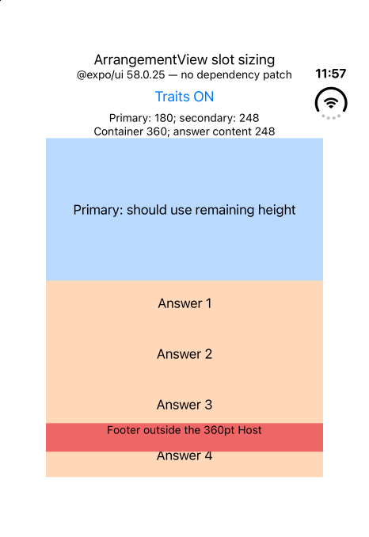
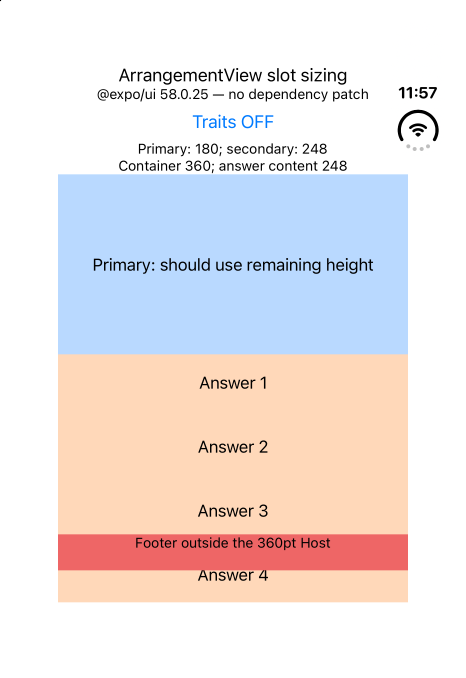
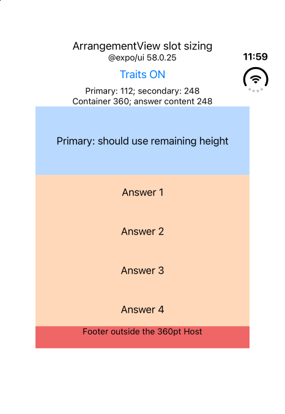

# Expo UI ArrangementView slot sizing reproduction

Upstream issue: [expo/expo#52674](https://github.com/expo/expo/issues/52674).

Minimal reproduction for `@expo/ui` **58.0.25**, the latest stable npm patch checked on
2026-10-30. Uses Expo 58.0.21, React 19.3.0, and React Native 0.88.1.
There is no dependency patch applied by installation.

## Run

Requires macOS, Xcode with the iOS 27.1 SDK, and an iOS 27.1+ simulator.
Tested on the iPhone Duo simulator's closed display (466 × 678 pt), Xcode 27.1 (27A9275).
No account, environment variables, application data, or third-party UI library is needed.

```sh
corepack pnpm install --frozen-lockfile
pnpm ios --device "iPhone Duo"
```

Use the standard Metro port 8081. If Metro is started separately, use `pnpm start`.
The native directories are generated by Expo; do not use Expo Go for the recorded comparison.

## Steps and results

1. Launch the application with the unmodified npm dependency.
2. Leave **Traits ON**. The secondary `VStack` has
   `splitArrangementFixedLayoutSize({ horizontal: false, vertical: true })` and `layoutPriority(1)`.
3. Read the measured heights above the layout and observe the fourth answer below the red footer.
4. Tap **Traits ON** to switch to **Traits OFF**. The measured heights and overflow do not change.

The vertical arrangement has a 360 pt container. The secondary content is four 56 pt rows with
three 8 pt gaps: 248 pt total. The primary can shrink to fit its single label.

Expected with traits ON: reserve 248 pt for secondary content and give the primary the remaining
112 pt. All four rows should remain above the footer.

Actual with traits ON **and** OFF: the primary measures 180 pt; secondary content measures 248 pt
and extends beyond its allocation, overlapping/passing the footer. `onGeometryChange` measures the
content views, not the private native slot frames.

The arranged content is entirely Expo SwiftUI `VStack` and `Text`. React Native supplies only the
outer screen, toggle, measured-height readout, `Host` frame, and footer. There is no `RNHostView`,
router, animation library, or application-specific layout logic.

### Unmodified dependency: traits ON



### Unmodified dependency: traits OFF



## Optional native control

This is a diagnostic comparison, not a proposed general API or production fix.

```sh
node native-slot-control.mjs
pnpm ios --device "iPhone Duo"
```

The script applies only these two lines to the `secondary` slot in
`node_modules/@expo/ui/ios/ArrangementViewView.swift`:

```swift
} secondary: {
  secondary
    .splitArrangementFixedLayoutSize(horizontal: false, vertical: true)
    .layoutPriority(1)
}
```

Rebuild the native app; a JavaScript reload is insufficient. The control hardcodes both traits,
so the JS toggle no longer turns the native traits off.

Observed after rebuilding: **primary 112 pt, secondary 248 pt**, with all four answers above the
footer. This points to the `SlotView` boundary as the cause; it does not imply that all Expo
modifiers or all slot-based components are affected.



Restore the unmodified source and rebuild to repeat the failing case:

```sh
node native-slot-control.mjs --revert
pnpm ios --device "iPhone Duo"
```

## Diagnostics

- [Environment](environment.txt), captured with `pnpm dlx expo-env-info`.
- [Expo Doctor](doctor.txt), captured with `pnpm dlx expo-doctor@latest`: 20/20 checks passed.
- Both unmodified and native-control Debug builds succeeded.

The screenshots were captured on the same simulator. No device folding is required to reproduce:
`arrangementViewStyle('split', { axes: 'vertical' })` makes the allocation deterministic.
